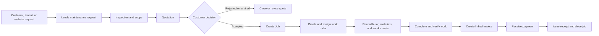

# SOMFIX Sales & Jobs Workflow

## Purpose

SOMFIX is a property-operations and field-service system. It should manage both:

1. property work requested by tenants or property owners; and
2. direct service sales, such as plumbing, electrical, AC, painting, cleaning, installation, and renovation.

`Sales & Jobs` connects a customer request to the quotation, operational work, invoice, payment, and job profit. It is the business workflow for services. A retail-style POS screen can be added later for walk-in sales of stocked items, but it is not the first priority.

## Current system coverage

| Current navigation area | What it already supports | Sales & Jobs role |
| --- | --- | --- |
| Dashboard | Business overview | Add service sales, outstanding invoices, and jobs requiring action. |
| Properties, Units, Tenants, Leases | Managed-property and tenant records | Links property-related jobs to the relevant site and tenant. |
| Website Requests | Public repair requests | Creates a maintenance request or a new sales lead. |
| Maintenance | Reported property issues, priority, cost, and completion | Tracks the reported issue before work is approved. |
| Work Orders | Assignment, scheduling, and completion of work | The operational job record. |
| Vendors & Technicians | People who carry out work | Assigned to job tasks and labor cost. |
| Finance: Quotations | Price offered to a customer | Commercial offer before customer approval. |
| Finance: Invoices | Customer billing and balance | Final billing after work or agreed deposit. |
| Inventory | Stock, cost, suppliers, and reorder level | Materials used by the job and their cost. |
| Reports | Operational and finance reporting | Sales funnel, collections, job margin, and technician performance. |

## Gap analysis

The existing modules provide most of the building blocks, but their relationship is not recorded as one business journey.

| Required capability | Current position | Sales & Jobs addition |
| --- | --- | --- |
| External customer | Tenant is available, but not every service customer is a tenant. | Add Customers: individual or company, phone, email, address, and linked properties. |
| Sales pipeline | Demo Requests capture interest but are not service sales. | Add Leads with source, service needed, owner, estimated value, and stage. |
| One linked job | Maintenance, quotation, work order, and invoice are separate records. | Add a Job record and link every document to it. |
| Customer approval | Quotation is sent, but approval is not a controlled status. | Add Sent, Accepted, Rejected, Expired, and Revised statuses plus approval date. |
| Job materials | Inventory exists, but material usage is not linked to a job. | Add Job Materials; deduct stock only when usage is confirmed. |
| Labor cost | Technician and work order exist but no cost log. | Add Job Labor entries: technician, hours, rate, and cost. |
| Payment evidence | Invoice has paid amount and balance only. | Add Payments with amount, method, transaction/reference number, proof, and recorder. |
| Quotation history | Converting a quotation currently changes it into an invoice. | Preserve the quotation and create a separately numbered linked invoice. |
| Profit | Estimated and actual maintenance costs exist, but not job margin. | Calculate revenue minus approved materials, labor, vendor, and other costs. |

## End-to-end workflow



### 1. Capture the request

The request can start from a tenant, property owner, website visitor, phone call, WhatsApp message, or walk-in customer.

- For an existing managed property, create a **Maintenance Request** and connect it to the property, unit, and tenant.
- For a direct service customer, create a **Lead** and connect it to a Customer.
- Record service category, customer problem, preferred visit time, photos, source, and urgency.

Suggested request statuses: `new`, `contacted`, `inspection scheduled`, `quoted`, `closed`.

### 2. Inspect and prepare the quotation

An estimator or technician visits the site, adds the work scope, labor estimate, materials estimate, and terms. Create a quotation with reusable line items.

Suggested quotation statuses: `draft`, `sent`, `accepted`, `rejected`, `expired`, `revised`.

The customer must accept the quotation before non-emergency work begins. Emergency repairs can skip this rule only when a manager records the reason.

### 3. Create the job and work order

When the quotation is accepted, create a **Job**. The job becomes the parent record for all field activity and billing.

Create one or more work orders under the job. Assign the technician, planned date, task list, safety notes, and estimated hours.

Suggested job statuses: `approved`, `scheduled`, `in progress`, `awaiting verification`, `completed`, `invoiced`, `closed`, `cancelled`.

### 4. Execute and record costs

The technician records:

- arrival and completion time;
- work completed and photos;
- inventory materials used;
- any extra materials or subcontractor costs;
- customer signature or completion confirmation.

Confirmed inventory usage reduces stock and creates a material-cost entry for the job. Extra work must create a change quotation or receive recorded customer approval before it is billed.

### 5. Verify completion and invoice

A supervisor verifies the work. Generate the invoice from the approved quotation plus approved changes and actual billable materials.

Never replace the quotation when invoicing. Keep these documents linked:

```text
Lead / Request → Job → Quotation Q-0001 → Work Order WO-0001 → Invoice INV-0001 → Payments
```

The invoice printout should show the merchant payment information:

```text
Merchant number: 65 21 09
USSD payment code: *789*652109*$#
Replace $ with the amount to pay.
Payment reference: invoice number
```

Suggested invoice statuses: `draft`, `sent`, `partially paid`, `paid`, `overdue`, `void`.

### 6. Receive payments and close the job

Every payment must be its own record. Store payment date, amount, method, reference/transaction ID, who recorded it, and optional proof image. Payments update the invoice balance automatically.

Payment methods should include `cash`, `EVC Plus / USSD`, `bank transfer`, and `other`.

Issue a printable receipt after each payment. Close a job only after work is verified and the financial balance is settled, waived with manager approval, or moved to collections.

## Recommended navigation

Add a top-level **Sales & Jobs** section between Operations and Finance:

```text
Sales & Jobs
  Leads
  Customers
  Jobs
  Quotations
  Payments
```

Keep **Maintenance** and **Work Orders** in Operations because technicians use them to deliver the work. Keep **Invoices** in Finance. The Jobs page provides the single place to see the related request, quotation, work orders, materials, invoice, payments, and job margin.

## Minimum new data model

| Record | Essential fields | Main links |
| --- | --- | --- |
| Customer | name, type, phone, email, address | Has many leads, jobs, quotations, invoices. |
| Lead | source, service category, description, stage, estimated value | Belongs to customer; may create a job. |
| Job | number, title, status, customer, property/unit, approved value | Belongs to customer; has work orders, quotations, invoice(s), costs, payments through invoices. |
| Payment | number, amount, date, method, reference, proof | Belongs to invoice. |
| Job Material | quantity, unit cost, selling price, approval status | Belongs to job and inventory item. |
| Job Labor | technician, hours, cost rate, selling rate | Belongs to job and technician. |

Each quotation and invoice needs a nullable `job_id`. Each work order needs a nullable `job_id`; property-maintenance work can initially link its maintenance record to the job.

## Reporting and dashboard measures

| Measure | Meaning |
| --- | --- |
| New leads | Requests not yet quoted. |
| Quote value | Total value of quotations by status. |
| Quote conversion rate | Accepted quotations divided by sent quotations. |
| Jobs in progress | Work that needs operational attention. |
| Revenue invoiced | Value of invoices issued in the period. |
| Cash collected | Sum of recorded payments in the period. |
| Outstanding balance | Open invoice balance. |
| Job gross profit | Invoice revenue minus material, labor, vendor, and other direct costs. |
| Low-stock materials | Inventory items under reorder level. |

## Delivery roadmap

### Phase 1: connect existing work

1. Add Job records and Customer records.
2. Link maintenance requests, work orders, quotations, and invoices to a job.
3. Preserve a quotation when creating a linked invoice.
4. Add the Sales & Jobs navigation and job detail page.

### Phase 2: control money and job costs

1. Add individual Payment records and printable receipts.
2. Add job material usage with inventory deduction.
3. Add labor and vendor cost entries.
4. Calculate invoice balances and job profit automatically.

### Phase 3: improve field operations

1. Add customer approval and change-order controls.
2. Add technician mobile completion, photos, signature, and time tracking.
3. Add WhatsApp/SMS notifications for quotation, appointment, invoice, and payment reminders.
4. Add sales and jobs reporting.

## End-to-end acceptance test

1. Create customer `Ayaan Construction` and a plumbing-service lead.
2. Record a site inspection and send a quotation for labor and pipe materials.
3. Mark the quotation accepted and create Job `JOB-0001`.
4. Assign a plumber through a work order.
5. Record two inventory materials and three labor hours against the job.
6. Mark the job completed after supervisor verification.
7. Create a linked invoice showing merchant number `65 21 09` and payment code `*789*652109*$#`.
8. Record a partial EVC Plus payment with its transaction reference and print a receipt.
9. Confirm the invoice is partially paid, the stock quantity is reduced, and job margin is visible.
10. Record the final payment and confirm that the job can be closed.
